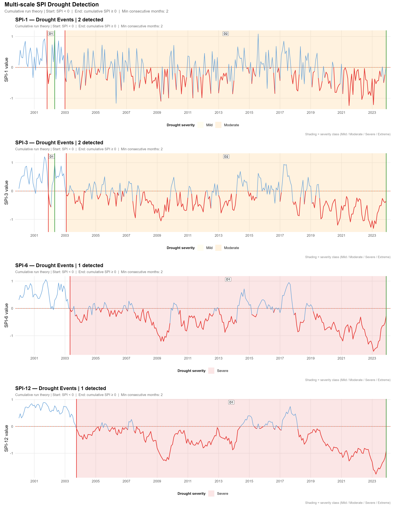
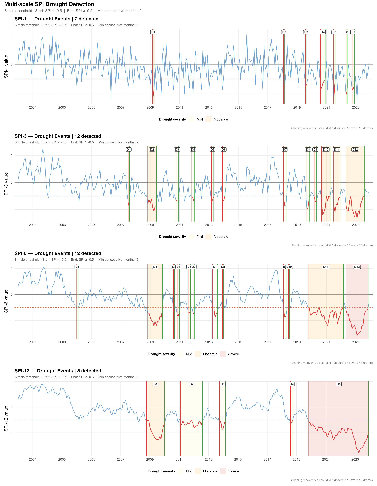
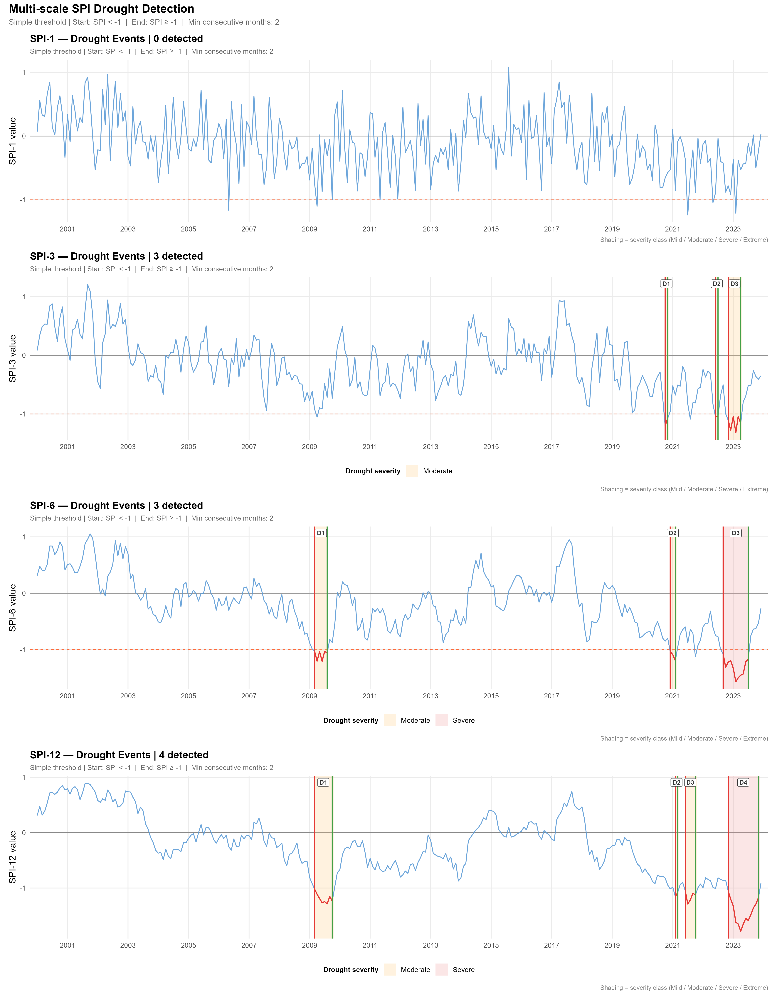
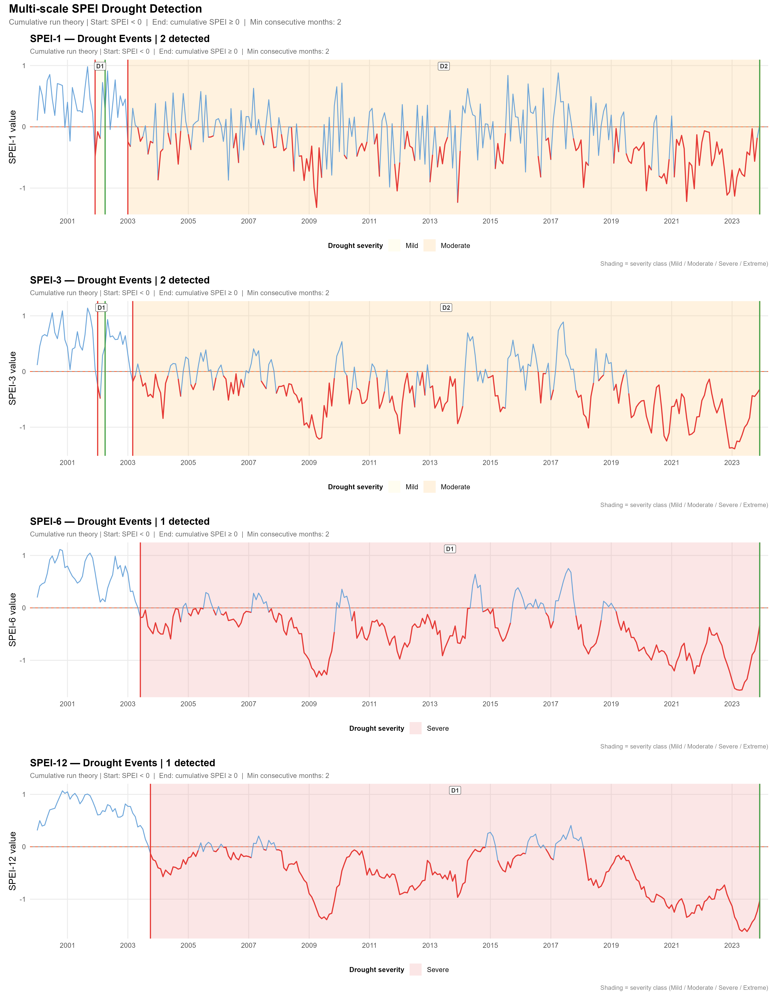
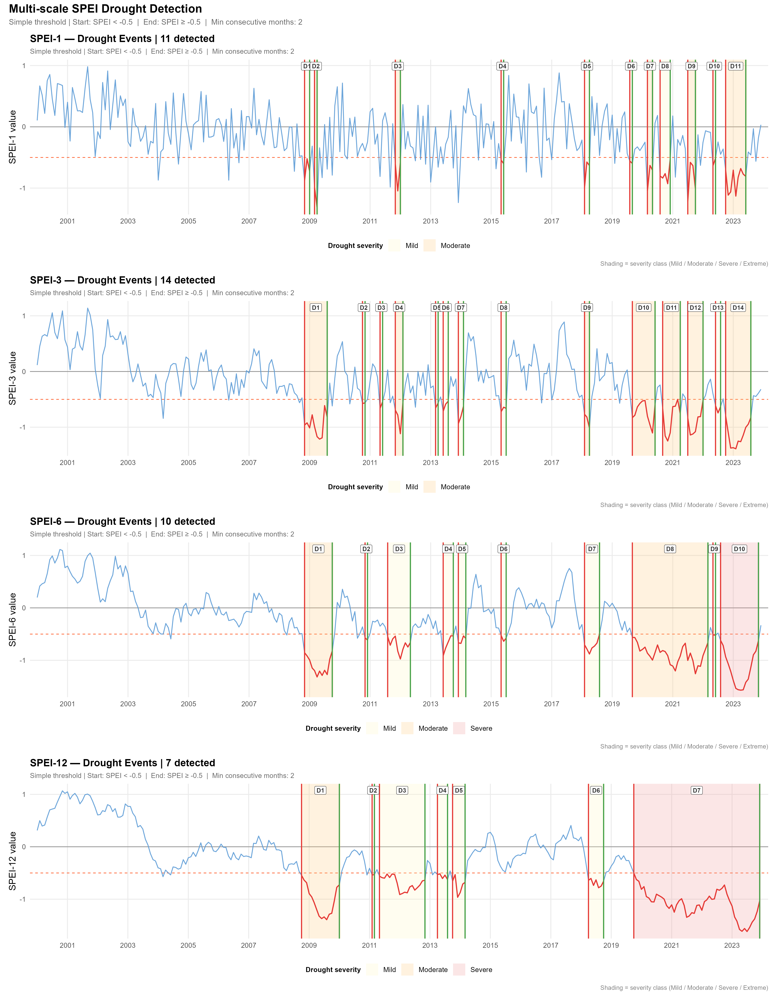
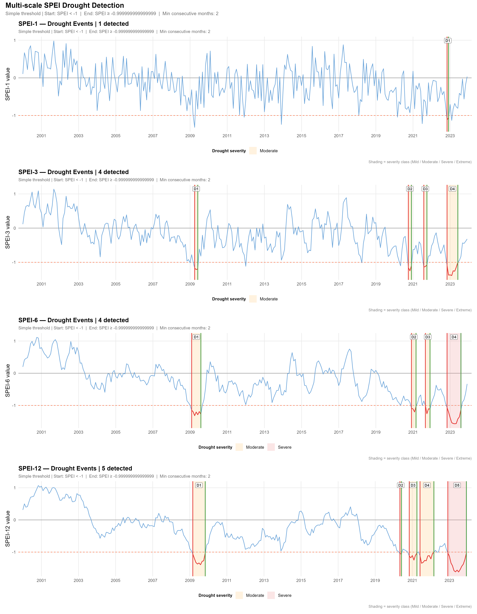

**Thresholds to define the beginning and end of a drought event**

We use a potential definition of drought events based on SPI and SPEI to determine drought events. Here we use ERA5 data from 2001 to 2023 to determine how Argentina would face drought events based on GWSC's potential definition of drought. Our goal here is to determine how these definitions will pick up drought events under a given climate scenario, and later evaluate them against true drought events to measure how well our definition performs.

## Thresholds Definition 01

Cumulative: drought begins when drought index is \< 0 for at least 2 months and ends when the sum of the negative values = the sum of the positive values. This method allows for a drought event to continue even with months of above normal rainfall. In practice, drought impacts don’t end with the first rain and it may take many months of above normal rain to recover from a drought event.

Based on above definition in Argentina's Drought event from 2001-2023 are summarized as follows:

```{r}
#| warning: false
#| message: false
#| echo: false
#| error: false

library(tidyverse)

df <- read.csv("Data/spi_drought_summary_def1.csv")


library(gt)

df |>
  select(SPI,mean_duration_months,mean_peak_spi,mean_sum_positive_spi,mean_total_severity,
         mean_min_cum_deficit,n_events) |>
  rename(
    `SPI time frame` = SPI,
    `Mean Duration (Months)` = mean_duration_months,
    `Mean Peak SPI (-)` = mean_peak_spi,
    `Mean cumi.sum SPI (+)` = mean_sum_positive_spi,
    `Mean cumi.sum SPI (-)`=mean_min_cum_deficit,
    `Net SPI during event` = mean_total_severity,
    `Total drought event` = n_events
  ) |>
  gt() |>
  tab_header(title = "Drought Event Summary : Definition 1") |>
  tab_options(
  heading.title.font.size = px(10)   # adjust size here
)|>
 # fmt_number(
 #   columns = c(`Total Weight using Parent code`, `Total Weight using Sub codes`),
 #  decimals = 0
 # ) |>
  fmt_missing(
    columns = everything(),    # or specify only columns you want
    missing_text = ""          # replace NA with empty string
  ) |>
  opt_stylize(style = 6) |>
  tab_options(
    table.font.size = px(8),
    data_row.padding = px(2)
  ) |>
  cols_width(
    `SPI time frame`                       ~ px(60),
    `Mean Duration (Months)`                 ~ px(60),
    `Mean Peak SPI (-)`                   ~ px(70),
    `Mean cumi.sum SPI (+)` ~ px(60),
    `Mean cumi.sum SPI (-)`   ~ px(70), 
    `Net SPI during event`           ~ px(70),
    `Total drought event` ~ px(60)
  )

```

{width="120%"}

## Thresholds Definition 02

–0.5: Number of consecutive months in which the drought index remained below –0.5. This method is a traditional way to define drought with a commonly accepted threshold. To initiate a drought event, there should be a minimum of two consecutive months where the SPI remains below –0.5, and once it returns to an SPI value greater than –0.5, the drought event ends. It does not need to return to a positive value — an SPI value that is still negative but higher than –0.5 would call off the drought event.

```{r}
#| warning: false
#| message: false
#| echo: false
#| error: false
#| tbl-pos: H

library(tidyverse)

df <- read.csv("Data/spi_drought_summary_def2.csv")


library(gt)

df |>
  select(SPI,mean_duration_months,mean_peak_spi,mean_sum_positive_spi,mean_total_severity,
         mean_min_cum_deficit,n_events) |>
  rename(
    `SPI time frame` = SPI,
    `Mean Duration (Months)` = mean_duration_months,
    `Mean Peak SPI (-)` = mean_peak_spi,
    `Mean cumi.sum SPI (+)` = mean_sum_positive_spi,
    `Mean cumi.sum SPI (-)`=mean_min_cum_deficit,
    `Net SPI during event` = mean_total_severity,
    `Total drought event` = n_events
  ) |>
  gt() |>
  tab_header(title = "Drought Event Summary : Definition 2") |>
  tab_options(latex.use_longtable = TRUE) |>
  tab_options(
  heading.title.font.size = px(10)   # adjust size here
)|>
 # fmt_number(
 #   columns = c(`Total Weight using Parent code`, `Total Weight using Sub codes`),
 #  decimals = 0
 # ) |>
  fmt_missing(
    columns = everything(),    # or specify only columns you want
    missing_text = ""          # replace NA with empty string
  ) |>
  opt_stylize(style = 6) |>
  tab_options(
    table.font.size = px(8),
    data_row.padding = px(2)
  ) |>
  cols_width(
    `SPI time frame`                       ~ px(60),
    `Mean Duration (Months)`                 ~ px(60),
    `Mean Peak SPI (-)`                   ~ px(70),
    `Mean cumi.sum SPI (+)` ~ px(60),
    `Mean cumi.sum SPI (-)`   ~ px(70), 
    `Net SPI during event`           ~ px(70),
    `Total drought event` ~ px(60)
  )

```

{width="120%"}

## Thresholds Definition 03

–1: Number of consecutive months in which the drought index remained below –1. This method is a traditional way to define drought with a commonly accepted threshold. To initiate a drought event, there should be a minimum of two consecutive months where the SPI remains below –1, and once it returns to an SPI value greater than –1, the drought event ends. It does not need to return to a positive value — an SPI value that is still negative but higher than –1 would call off the drought event.

```{r}
#| warning: false
#| message: false
#| echo: false
#| error: false

library(tidyverse)

df <- read.csv("Data/spi_drought_summary_def3.csv")


library(gt)

df |>
  select(SPI,mean_duration_months,mean_peak_spi,mean_sum_positive_spi,mean_total_severity,
         mean_min_cum_deficit,n_events) |>
  rename(
    `SPI time frame` = SPI,
    `Mean Duration (Months)` = mean_duration_months,
    `Mean Peak SPI (-)` = mean_peak_spi,
    `Mean cumi.sum SPI (+)` = mean_sum_positive_spi,
    `Mean cumi.sum SPI (-)`=mean_min_cum_deficit,
    `Net SPI during event` = mean_total_severity,
    `Total drought event` = n_events
  ) |>
  gt() |>
  tab_header(title = "Drought Event Summary : Definition 3") |>
  tab_options(
  heading.title.font.size = px(10)   # adjust size here
)|>
      tab_options(latex.use_longtable = TRUE) |>
 # fmt_number(
 #   columns = c(`Total Weight using Parent code`, `Total Weight using Sub codes`),
 #  decimals = 0
 # ) |>
  fmt_missing(
    columns = everything(),    # or specify only columns you want
    missing_text = ""          # replace NA with empty string
  ) |>
  opt_stylize(style = 6) |>
  tab_options(
    table.font.size = px(8),
    data_row.padding = px(2)
  ) |>
  cols_width(
    `SPI time frame`                       ~ px(60),
    `Mean Duration (Months)`                 ~ px(60),
    `Mean Peak SPI (-)`                   ~ px(70),
    `Mean cumi.sum SPI (+)` ~ px(60),
    `Mean cumi.sum SPI (-)`   ~ px(70), 
    `Net SPI during event`           ~ px(70),
    `Total drought event` ~ px(60)
  )

```

{width="120%"}

\newpage

**Based on SPEI**

## Thresholds Definition 01

```{r}
#| warning: false
#| message: false
#| echo: false
#| error: false

library(tidyverse)

df <- read.csv("Data/spei_drought_summary_def1.csv")


library(gt)

df |>
  select(SPEI,mean_duration_months,mean_peak_spei,mean_sum_positive_spei,mean_total_severity,
         mean_min_cum_deficit,n_events) |>
  rename(
    `SPEI time frame` = SPEI,
    `Mean Duration (Months)` = mean_duration_months,
    `Mean Peak SPEI (-)` = mean_peak_spei,
    `Mean cumi.sum SPEI (+)` = mean_sum_positive_spei,
    `Mean cumi.sum SPEI (-)`=mean_min_cum_deficit,
    `Severity (+) - (-)` = mean_total_severity,
    `Total drought event` = n_events
  ) |>
  gt() |>
  tab_header(title = "Drought Event Summary : Definition 1") |>
  tab_options(
  heading.title.font.size = px(10)   # adjust size here
)|>
    tab_options(latex.use_longtable = TRUE) |>
 # fmt_number(
 #   columns = c(`Total Weight using Parent code`, `Total Weight using Sub codes`),
 #  decimals = 0
 # ) |>
  fmt_missing(
    columns = everything(),    # or specify only columns you want
    missing_text = ""          # replace NA with empty string
  ) |>
  opt_stylize(style = 6) |>
  tab_options(
    table.font.size = px(8),
    data_row.padding = px(2)
  ) |>
  cols_width(
    `SPEI time frame`                       ~ px(60),
    `Mean Duration (Months)`                 ~ px(60),
    `Mean Peak SPEI (-)`                   ~ px(70),
    `Mean cumi.sum SPEI (+)` ~ px(60),
    `Mean cumi.sum SPEI (-)`   ~ px(70), 
    `Severity (+) - (-)`           ~ px(70),
    `Total drought event` ~ px(60)
  )

```

{width="120%"}

## Thresholds Definition 02

```{r}
#| warning: false
#| message: false
#| echo: false
#| error: false

library(tidyverse)

df <- read.csv("Data/spei_drought_summary_def2.csv")


library(gt)

df |>
  select(SPEI,mean_duration_months,mean_peak_spei,mean_sum_positive_spei,mean_total_severity,
         mean_min_cum_deficit,n_events) |>
  rename(
    `SPI time frame` = SPEI,
    `Mean Duration (Months)` = mean_duration_months,
    `Mean Peak SPEI (-)` = mean_peak_spei,
    `Mean cumi.sum SPEI (+)` = mean_sum_positive_spei,
    `Mean cumi.sum SPEI (-)`=mean_min_cum_deficit,
    `Severity (+) - (-)` = mean_total_severity,
    `Total drought event` = n_events
  ) |>
  gt() |>
  tab_header(title = "Drought Event Summary : Definition 2") |>
  tab_options(
  heading.title.font.size = px(10)   # adjust size here
)|>
 # fmt_number(
 #   columns = c(`Total Weight using Parent code`, `Total Weight using Sub codes`),
 #  decimals = 0
 # ) |>
  fmt_missing(
    columns = everything(),    # or specify only columns you want
    missing_text = ""          # replace NA with empty string
  ) |>
  opt_stylize(style = 6) |>
  tab_options(
    table.font.size = px(8),
    data_row.padding = px(2)
  ) |>
  cols_width(
    `SPI time frame`                       ~ px(60),
    `Mean Duration (Months)`                 ~ px(60),
    `Mean Peak SPEI (-)`                   ~ px(70),
    `Mean cumi.sum SPEI (+)` ~ px(60),
    `Mean cumi.sum SPEI (-)`   ~ px(70), 
    `Severity (+) - (-)`           ~ px(70),
    `Total drought event` ~ px(60)
  )

```

{width="120%"}

## Thresholds Definition 03

```{r}
#| warning: false
#| message: false
#| echo: false
#| error: false

library(tidyverse)

df <- read.csv("Data/spei_drought_summary_def3.csv")


library(gt)

df |>
  select(SPEI,mean_duration_months,mean_peak_spei,mean_sum_positive_spei,mean_total_severity,
         mean_min_cum_deficit,n_events) |>
  rename(
    `SPEI time frame` = SPEI,
    `Mean Duration (Months)` = mean_duration_months,
    `Mean Peak SPEI (-)` = mean_peak_spei,
    `Mean cumi.sum SPEI (+)` = mean_sum_positive_spei,
    `Mean cumi.sum SPEI (-)`=mean_min_cum_deficit,
    `Severity (+) - (-)` = mean_total_severity,
    `Total drought event` = n_events
  ) |>
  gt() |>
  tab_header(title = "Drought Event Summary : Definition 3") |>
  tab_options(
  heading.title.font.size = px(10)   # adjust size here
)|>
 # fmt_number(
 #   columns = c(`Total Weight using Parent code`, `Total Weight using Sub codes`),
 #  decimals = 0
 # ) |>
  fmt_missing(
    columns = everything(),    # or specify only columns you want
    missing_text = ""          # replace NA with empty string
  ) |>
  opt_stylize(style = 6) |>
  tab_options(
    table.font.size = px(8),
    data_row.padding = px(2)
  ) |>
  cols_width(
    `SPEI time frame`                       ~ px(60),
    `Mean Duration (Months)`                 ~ px(60),
    `Mean Peak SPEI (-)`                   ~ px(70),
    `Mean cumi.sum SPEI (+)` ~ px(60),
    `Mean cumi.sum SPEI (-)`   ~ px(70), 
    `Severity (+) - (-)`           ~ px(70),
    `Total drought event` ~ px(60)
  )

```

{width="120%"}
